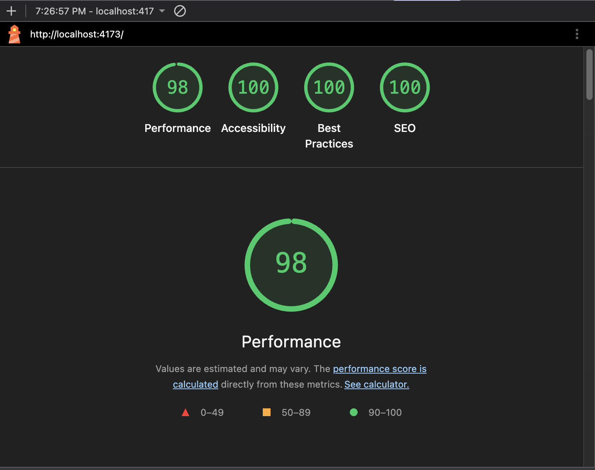

# ☕ Café de Altura — Catálogo PWA

**Práctica 1: Desarrollo y Coevaluación de una Aplicación Web Progresiva Básica**

Catálogo estático de cafés de especialidad construido como PWA:

- **Frontend:** React 19 + Vite → renderizado del lado del cliente (CSR), App Shell, manifiesto y Service Worker escrito a mano.
- **Backend:** Java 21 + Spring Boot 4 → API REST `GET /api/productos` que provee el catálogo.

> Para poder publicarse en GitHub Pages o Netlify (hosting estático con HTTPS), la PWA también incluye una copia del catálogo en `frontend/public/data/productos.json`. Si se define la variable `VITE_API_URL`, la app consume la API de Spring Boot en su lugar.

---

## Estructura del repositorio

```
pwa-catalogo/
├── backend/                        # API REST (Spring Boot)
│   ├── pom.xml
│   └── src/main/java/com/utch/catalogo/
│       ├── CatalogoApplication.java
│       ├── controller/ProductoController.java   # GET /api/productos y /api/productos/{id}
│       ├── model/Producto.java                  # record con los datos de cada café
│       └── config/CorsConfig.java               # permite que la PWA publicada consuma la API
├── frontend/                       # PWA (React + Vite)
│   ├── index.html                  # App Shell inicial con CSS crítico en línea
│   ├── vite.config.js              # plugin que inyecta la lista de precache en sw.js
│   ├── public/
│   │   ├── manifest.json           # ★ Manifiesto web
│   │   ├── sw.js                   # ★ Service Worker
│   │   ├── offline.html            # ★ Página amigable sin conexión
│   │   ├── icons/                  # iconos 192/512 normales y maskable
│   │   └── data/productos.json     # catálogo estático
│   ├── scripts/generar-iconos.mjs  # genera los PNG de los iconos
│   └── src/
│       ├── main.jsx                # monta React y registra el SW
│       ├── registrarSW.js          # registro + aviso de nueva versión
│       ├── App.jsx                 # ★ App Shell (header, nav, main, footer)
│       ├── hooks/                  # useProductos, useOnline, useRuta
│       └── components/             # Catalogo, DetalleProducto, VistaOffline, etc.
├── docs/COEVALUACION.md            # lista de cotejo para el equipo evaluador
├── netlify.toml                    # despliegue en Netlify
└── .github/workflows/deploy-pages.yml  # despliegue en GitHub Pages
```

---

## Cómo ejecutarlo localmente

### Requisitos
- Node.js 20+ y npm
- Java 21+ y Maven (o el wrapper `./mvnw` incluido)

### 1. Frontend (PWA)

```bash
cd frontend
npm install
npm run build      # genera dist/ e inyecta la lista de precache en dist/sw.js
npm run preview    # http://localhost:4173
```

> ⚠️ El Service Worker **solo se registra en el build de producción** (`build` + `preview`), no con `npm run dev`. `localhost` cuenta como origen seguro, así que no hace falta HTTPS en local.

### 2. Backend (opcional, Spring Boot)

```bash
cd backend
./mvnw spring-boot:run           # http://localhost:8080/api/productos
./mvnw test                      # pruebas del controlador
```

Para que la PWA consuma la API en lugar del JSON estático:

```bash
cd frontend
VITE_API_URL=http://localhost:8080 npm run build && npm run preview
```

Para servir la PWA desde el propio Spring Boot (un solo `.jar`):

```bash
cd frontend && npm run build:spring      # copia el build a backend/src/main/resources/static
cd ../backend && ./mvnw spring-boot:run  # http://localhost:8080
```

---

## Despliegue con HTTPS

### Opción A — GitHub Pages
1. Sube el repositorio a GitHub (rama `main`).
2. En **Settings → Pages → Source** elige **GitHub Actions**.
3. Cada `push` a `main` ejecuta `.github/workflows/deploy-pages.yml` y publica en `https://<usuario>.github.io/<repo>/`.

### Opción B — Netlify
1. En Netlify: **Add new site → Import an existing project** y selecciona el repositorio.
2. Netlify lee `netlify.toml` (base `frontend`, comando `npm run build`, carpeta `dist`).

Las rutas son relativas (`base: './'` y `start_url: "./"`), así que funciona igual en la raíz o en un subdirectorio.

---

## Cómo cumple cada criterio de la lista de cotejo

| # | Criterio | Dónde se cumple |
|---|----------|-----------------|
| 1 | Repositorio y estructura | Monorepo separado en `backend/` y `frontend/`, componentes y hooks en carpetas propias, `.gitignore`, README. |
| 2 | Manifiesto web | `frontend/public/manifest.json`: `name`, `short_name`, `start_url`, `display: "standalone"`, `theme_color`, iconos 192 y 512 `any` + `maskable` (adaptativos). |
| 3 | App Shell con CSR | `index.html` pinta un shell inicial con CSS crítico en línea; React (`App.jsx`) monta el shell fijo (header/nav/footer) y renderiza en el cliente solo el `<main>` según la ruta `#/…`; esqueletos de carga evitan saltos visuales. |
| 4 | Service Worker y caché | `src/registrarSW.js` registra `sw.js`. En `install` precachea todo el App Shell (lista generada en el build), en `activate` borra cachés viejas, y en `fetch` intercepta: *cache first* para estáticos, *network first* para datos y navegación. |
| 5 | Funcionamiento offline | Indicador "Sin conexión" en el header, banner amigable, catálogo servido desde caché, `VistaOffline` si no hay datos y `offline.html` como último respaldo. |
| 6 | Lighthouse | Performance 98, Accessibility 100, Best Practices 100, SEO 100 (ver resultados abajo). Instalable sin errores. |

### Resultados de Lighthouse

Auditoría ejecutada en Chrome DevTools sobre el build de producción (`npm run build && npm run preview`, `http://localhost:4173/`) el 24 de noviembre de 2026.

| Performance | Accessibility | Best Practices | SEO |
|:-----------:|:-------------:|:--------------:|:---:|
| **98** | **100** | **100** | **100** |



### Nota sobre Lighthouse
A partir de **Lighthouse 12** (Chrome 126+) se eliminó la categoría "PWA". Para evidenciar las métricas PWA:
1. **DevTools → Lighthouse**: ejecuta Performance, Accessibility, Best Practices y SEO.
2. **DevTools → Application → Manifest**: debe mostrar el manifiesto sin errores de instalabilidad.
3. **DevTools → Application → Service Workers**: estado *activated and is running*.
4. El ícono de **instalar** aparece en la barra de direcciones de Chrome/Edge.

---

## Cómo probar el modo offline (para el equipo evaluador)
1. Abre la URL publicada y espera a que cargue (el SW se instala en la primera visita).
2. Recarga una vez. En **DevTools → Application → Service Workers** verifica que esté activo.
3. En **Application → Cache Storage** verás `shell-<versión>` y `datos-v1`.
4. Marca **Offline** (en *Network* o en *Application → Service Workers*) y recarga.
5. La app debe seguir mostrando el catálogo, el indicador "Sin conexión" y el banner informativo; los detalles de producto también abren.
